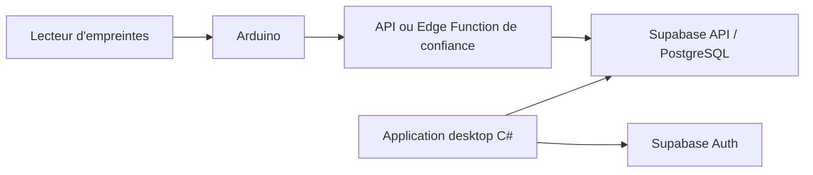

<div align="center">

# FingerTrack

### Système de pointage par empreinte digitale

Application desktop **C# / Windows Forms** · Lecteur **Arduino** · Base **Supabase / PostgreSQL**

</div>

---

## Sommaire

- [À propos](#à-propos)
- [État du projet](#état-du-projet)
- [Architecture](#architecture)
- [Organisation du dépôt](#organisation-du-dépôt)
- [Prérequis](#prérequis)
- [Récupérer le projet](#récupérer-le-projet)
- [Démarrer Supabase en local](#démarrer-supabase-en-local)
- [Connexion de l'application C#](#connexion-de-lapplication-c)
- [Modèle de données et sécurité](#modèle-de-données-et-sécurité)
- [Workflow GitHub](#workflow-github)
- [Accès de l'équipe](#accès-de-léquipe)
- [Ressources officielles](#ressources-officielles)

## À propos

FingerTrack est un système de pointage qui associera un lecteur d'empreintes connecté à une carte Arduino à une application desktop C#. **Supabase** fournit la base PostgreSQL, l'authentification et les API utilisées par l'application.

Ce dépôt contient la solution C# existante et les premiers dossiers de documentation. Le firmware Arduino, le schéma complet et le flux de pointage restent à développer avec l'équipe.

## État du projet

- Application Windows Forms : squelette initial dans `fingertrack/`.
- Arduino : dossier de départ dans `arduino/`.
- Supabase : configuration locale à créer avec la CLI et à versionner sous `supabase/`.
- Base distante : à utiliser uniquement avec l'accès du projet Supabase de l'équipe.

## Architecture



L'application C# s'authentifie avec Supabase Auth et accède aux données selon les politiques Row Level Security (RLS). L'Arduino ne doit contenir aucune clé secrète ; son protocole d'identification et son accès d'écriture doivent être définis côté backend/Edge Function.

## Organisation du dépôt

```text
FingerTrack/
├── arduino/                    # Firmware et code de l'appareil
├── docs/                       # Architecture et décisions
├── fingertrack/                # Application Windows Forms C#
├── supabase/
│   ├── config.toml             # Configuration de la CLI locale
│   ├── migrations/             # Changements versionnés du schéma SQL
│   └── seed.sql                # Données locales non sensibles (optionnel)
├── fingertrack.slnx            # Solution Visual Studio
└── .gitignore                  # Secrets et fichiers générés exclus de Git
```

## Prérequis

- Git pour Windows ou Linux.
- Visual Studio avec la charge de travail **Développement .NET Desktop**.
- Arduino IDE pour développer et téléverser le firmware.
- Node.js 20+ (Node 24 LTS recommandé) pour lancer la CLI Supabase via npm/npx.
- Docker Desktop, ou un moteur compatible Docker, démarré avant l'émulateur local Supabase.

Vérifier les outils :

```powershell
git --version
node --version
docker --version
docker compose version
dotnet --version
```

## Récupérer le projet

Chaque membre clone le dépôt une fois :

```bash
git clone https://github.com/devegend/FingerTrack.git
cd FingerTrack
```

Si GitHub demande une connexion, utiliser le navigateur ou Git Credential Manager. Ne jamais partager un mot de passe, un token ou une clé d'accès dans le dépôt, dans un commit ou dans le chat.

## Démarrer Supabase en local

La CLI locale démarre PostgreSQL, Auth et les API dans des conteneurs Docker. Ces services et leurs données sont locaux et séparés du projet hébergé.

À la racine du dépôt, installer la CLI comme dépendance de développement et créer la configuration locale :

```powershell
npm.cmd install --save-dev supabase
npx.cmd supabase init
```

Sous Linux :

```bash
npm install --save-dev supabase
npx supabase init
```

Lancer la pile locale :

```powershell
npx.cmd supabase start
```

```bash
npx supabase start
```

Au premier lancement, Docker télécharge les images nécessaires. La commande affiche les adresses locales, les clés locales et les autres informations de connexion. Garder ces valeurs sur la machine et utiliser celles fournies pour le démarrage local. Supabase Studio est généralement disponible à `http://127.0.0.1:54323`; l'adresse API et le port PostgreSQL sont affichés par la CLI.

Arrêter les services locaux avec :

```powershell
npx.cmd supabase stop
```

Ne lancez pas `supabase db push` vers le projet hébergé sans revue et accord de l'équipe. Pour développer localement, utiliser les migrations sous `supabase/migrations` et le stack Docker.

## Connexion de l'application C#

Le client C# officiel s'installe depuis NuGet. À partir du dossier qui contient le fichier `.csproj` :

```powershell
dotnet add package supabase-csharp
```

La configuration de l'application utilise l'URL Supabase et une clé **publishable**. Pour travailler en local, prendre les valeurs de l'instance locale ; pour un environnement hébergé, le propriétaire du projet fournit l'URL et la clé publishable depuis le Dashboard.

Les clés publishable peuvent être utilisées dans un client avec des politiques RLS correctes. Les clés `secret` et les anciennes clés `service_role` sont réservées au backend et ne doivent jamais être intégrées dans l'application desktop ou le firmware Arduino.

## Modèle de données et sécurité

Le schéma initial reste à décider avec l'équipe. Une base possible comprend :

- `employees` : profil de l'employé associé à son identité Auth ;
- `devices` : appareils enregistrés, statut et identifiant non secret ;
- `attendance_events` : employé, appareil, type d'événement et heure de réception serveur.

À chaque table exposée par l'API, activer RLS et écrire des politiques qui limitent les opérations à l'utilisateur et au rôle appropriés. Ne pas compter sur une clé publishable comme contrôle d'accès : elle identifie le projet, tandis que Auth et RLS décident des opérations permises.

Ne stockez pas les images ni les modèles d'empreintes dans PostgreSQL. Gardez le traitement biométrique sur le lecteur ou dans un système protégé conçu pour cela ; transmettez uniquement l'identifiant utilisateur et les données minimales nécessaires au pointage.

## Workflow GitHub

Ne travaillez pas directement sur `main`. Créez une branche par tâche :

```bash
git switch main
git pull --ff-only origin main
git switch -c feature/nom-de-la-tache
```

Exemples : `feature/arduino-reader`, `feature/login-screen`, `feature/attendance-schema`.

Après les modifications :

```bash
git status
git add chemin/du/fichier
git commit -m "Add a short description"
git push -u origin feature/nom-de-la-tache
```

Ouvrir ensuite une Pull Request vers `main`. Après sa fusion, mettre à jour la copie locale :

```bash
git switch main
git pull --ff-only origin main
```

Pour récupérer les changements des autres, utilisez `git pull` dans la copie existante ; ne clonez pas le dépôt à nouveau. Les fichiers `.env`, mots de passe, tokens, clés secrètes, données personnelles, dossiers `bin/`, `obj/` et fichiers temporaires ne doivent jamais être commités.

## Accès de l'équipe

L'organisation ou le propriétaire Supabase invite chaque membre avec son compte Supabase et attribue un rôle sur l'organisation ou sur le projet concerné. Le rôle **Developer** permet l'accès au contenu des projets, mais pas la modification des paramètres de projet. Si le projet n'apparaît pas, vérifier que l'invitation a été acceptée avec le compte exact et que le rôle est attribué au bon projet.

Pour les clés de plateforme ou les opérations d'administration, demander au propriétaire d'intervenir. Ne demandez et ne partagez jamais son mot de passe, un token personnel Supabase, le mot de passe PostgreSQL, ou une clé `secret` / `service_role`.

## Ressources officielles

- [Supabase Local Development et CLI](https://supabase.com/docs/guides/local-development)
- [Workflow de développement local et migrations](https://supabase.com/docs/guides/local-development/cli-workflows)
- [Contrôle d'accès de l'organisation et des projets](https://supabase.com/docs/guides/platform/access-control)
- [Clés API Supabase](https://supabase.com/docs/guides/getting-started/api-keys)
- [Client C# Supabase](https://supabase.com/docs/reference/csharp/v0)
