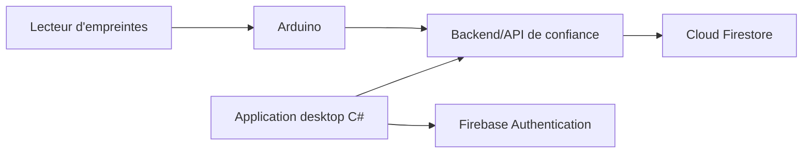

<div align="center">

# FingerTrack

### Système de pointage par empreinte digitale

Application desktop **C# / Windows Forms** · Lecteur **Arduino** · Backend **Firebase**

</div>

---

## Sommaire

- [À propos](#à-propos)
- [État du projet](#état-du-projet)
- [Architecture](#architecture)
- [Organisation des fichiers](#organisation-des-fichiers)
- [Prérequis](#prérequis)
- [Récupérer le projet](#récupérer-le-projet)
- [Lancer Firebase en local](#lancer-firebase-en-local)
- [Comprendre Firebase dans FingerTrack](#comprendre-firebase-dans-fingertrack)
- [Travailler en équipe avec Git](#travailler-en-équipe-avec-git)
- [Sécurité et données biométriques](#sécurité-et-données-biométriques)
- [Ressources officielles](#ressources-officielles)

## À propos

FingerTrack est un projet de pointage qui associera un lecteur d'empreintes relié à une carte Arduino à une application desktop C#. Firebase servira à gérer l'authentification et les données de présence.

Le dépôt GitHub est privé. Chaque membre doit être ajouté comme collaborateur avec les droits nécessaires par le propriétaire du dépôt.

## État du projet

Cette branche de départ contient la solution C# Windows Forms, les dossiers de travail Arduino, les fichiers de configuration Firebase, des règles Firestore restrictives et la documentation.

Les points suivants restent à réaliser par l'équipe :

- le firmware Arduino et l'enrôlement des appareils ;
- le backend/API de confiance qui valide les appareils et enregistre les pointages ;
- la connexion Firebase dans l'application C# ;
- les scénarios d'accès et la validation des règles avant leur déploiement.

Les services Firestore et Authentication ont été signalés comme activés dans le projet Firebase. La configuration du dépôt ne modifie pas ces services ni les rôles IAM.

## Architecture



L'Arduino et l'application C# ne doivent jamais contenir de clé de compte de service. L'API vérifie les utilisateurs et appareils autorisés, puis écrit les événements dans Firestore avec une identité serveur protégée.

## Organisation des fichiers

```text
FingerTrack/
├── arduino/                    # Firmware Arduino (à développer)
├── docs/                       # Architecture et consignes
├── fingertrack/                # Application Windows Forms C#
├── fingertrack.slnx            # Solution Visual Studio
├── firebase.json               # Configuration CLI et émulateurs
├── firestore.rules             # Règles d'accès Firestore
├── firestore.indexes.json      # Index Firestore
└── .firebaserc                 # Projet Firebase associé
```

## Prérequis

- Git pour Windows ou Git sous Linux.
- Visual Studio avec la charge de travail **Développement .NET Desktop** pour l'application C#.
- Arduino IDE pour le firmware lorsqu'il sera ajouté.
- Node.js **24 LTS** recommandé, puis Firebase CLI. Firebase CLI peut s'installer avec Node/npm ; PowerShell peut nécessiter `npm.cmd` au lieu de `npm`.
- JDK **21 ou plus récent** pour démarrer Firestore Emulator avec la version actuelle de Firebase CLI utilisée par l'équipe.

Vérifier les installations :

```powershell
git --version
node --version
npm.cmd --version
firebase.cmd --version
java -version
```

Installer Firebase CLI sous Windows :

```powershell
npm.cmd install -g firebase-tools
```

Sous Linux, utiliser `npm install -g firebase-tools`, puis la commande `firebase`.

## Récupérer le projet

Chaque membre clone le dépôt **une seule fois** :

```powershell
git clone https://github.com/devegend/FingerTrack.git
cd FingerTrack
```

Sous Linux, les deux commandes sont identiques. Si GitHub demande une connexion, authentifiez-vous avec Git Credential Manager ou le navigateur ; ne partagez jamais votre mot de passe ou un token dans le dépôt ou le chat.

Pour contribuer, le propriétaire du dépôt doit d'abord ajouter le compte GitHub du membre comme collaborateur. Les changements passent par une branche et une Pull Request.

## Lancer Firebase en local

Les émulateurs permettent de développer avec Auth et Firestore sur la machine, sans toucher aux données de production.

À la racine du dépôt, dans PowerShell :

```powershell
firebase.cmd emulators:start --only auth,firestore
```

Sous Linux :

```bash
firebase emulators:start --only auth,firestore
```

Adresses locales :

| Service | Adresse |
|---|---|
| Authentication Emulator | `http://127.0.0.1:9099` |
| Firestore Emulator | `http://127.0.0.1:8080` |
| Emulator UI | `http://127.0.0.1:4000` |

Garder le terminal ouvert pendant le développement. Pour arrêter les émulateurs, utiliser `Ctrl+C` dans ce terminal. Les comptes et données créés dans les émulateurs sont des données de développement locales.

Si Java 8 est sélectionné malgré l'installation d'un JDK récent, configurer `JAVA_HOME` et `PATH` pour utiliser le JDK 21 ou supérieur, puis ouvrir un nouveau terminal. L'émulateur Firestore ne démarre pas avec Java 8.

## Comprendre Firebase dans FingerTrack

Le fichier `.firebaserc` associe la CLI au projet `fndvmiltkpzaazeuqikq`. `firebase.json` indique à la CLI où trouver les règles et quels émulateurs démarrer.

### Firestore

Firestore est la base de données de documents. Le schéma de départ proposé est :

- `users/{uid}` : profil et statut utilisateur ;
- `devices/{deviceId}` : appareil enregistré et son statut ;
- `attendanceEvents/{eventId}` : identifiant utilisateur, appareil, type de pointage et dates.

Les règles dans `firestore.rules` refusent l'accès par défaut. Un utilisateur connecté peut lire son propre profil et ses propres pointages. Les événements ne peuvent pas être créés, modifiés ou supprimés directement depuis le client : le backend devra valider chaque requête avant l'écriture.

### Authentication

Firebase Authentication sert à identifier les utilisateurs de l'application. Les comptes de test doivent être créés dans l'Authentication Emulator pendant le développement local. Les rôles privilégiés doivent être attribués par un mécanisme de confiance ; une application cliente ne doit pas pouvoir se déclarer administratrice.

### Développement local et projet en ligne

Par défaut, utiliser les émulateurs pour le développement et les essais. La connexion à la console ou le déploiement en production nécessite l'autorisation du propriétaire du projet. Ne déployer aucune règle avant revue par l'équipe.

## Travailler en équipe avec Git

Ne travaillez pas directement sur `main`. Pour chaque tâche, créez une branche dédiée.

### Première contribution et mises à jour

Après le premier `git clone`, avant de commencer une nouvelle tâche :

```bash
git switch main
git pull --ff-only origin main
git switch -c feature/nom-de-la-tache
```

Exemple de nom : `feature/arduino-reader` ou `feature/login-screen`.

### Enregistrer et partager son travail

Après avoir modifié le code :

```bash
git status
git add chemin/du/fichier
git commit -m "Add a short description"
git push -u origin feature/nom-de-la-tache
```

Ensuite, ouvrez GitHub et créez une **Pull Request** de votre branche vers `main`. Après validation et fusion, mettez votre copie locale à jour :

```bash
git switch main
git pull --ff-only origin main
```

Ne faites pas un nouveau `git clone` pour obtenir les changements : utilisez `git pull` dans la copie existante. Ne poussez jamais de mot de passe, token, fichier de compte de service ou donnée personnelle.

## Sécurité et données biométriques

- Ne commitez jamais de clés privées, mots de passe, tokens, fichiers JSON de compte de service, ou paramètres locaux contenant des secrets.
- N'intégrez pas de clé Firebase Admin dans Arduino ou l'application C#.
- Ne stockez pas d'images ou de modèles d'empreintes dans Firestore. Conservez le traitement biométrique sur le lecteur ou dans un système protégé conçu à cet effet ; le pointage transmis doit identifier l'utilisateur sans transmettre son empreinte.
- Enregistrez seulement les informations nécessaires au pointage et définissez une durée de conservation avec l'équipe.
- Les règles Firestore protègent les accès clients. Le backend utilise l'Admin SDK, qui contourne ces règles : il doit donc vérifier lui-même chaque utilisateur, appareil et événement.
- Le propriétaire du projet Firebase gère les rôles IAM et attribue uniquement les accès requis pour chaque tâche.

## Ressources officielles

- [Firebase CLI](https://firebase.google.com/docs/cli)
- [Firebase Local Emulator Suite](https://firebase.google.com/docs/emulator-suite/install_and_configure)
- [Firestore Security Rules](https://firebase.google.com/docs/firestore/security/get-started)
- [Créer un dépôt GitHub](https://docs.github.com/en/repositories/creating-and-managing-repositories/creating-a-new-repository)
- [Ajouter un projet local à GitHub](https://docs.github.com/en/migrations/importing-source-code/using-the-command-line-to-import-source-code/adding-locally-hosted-code-to-github)
